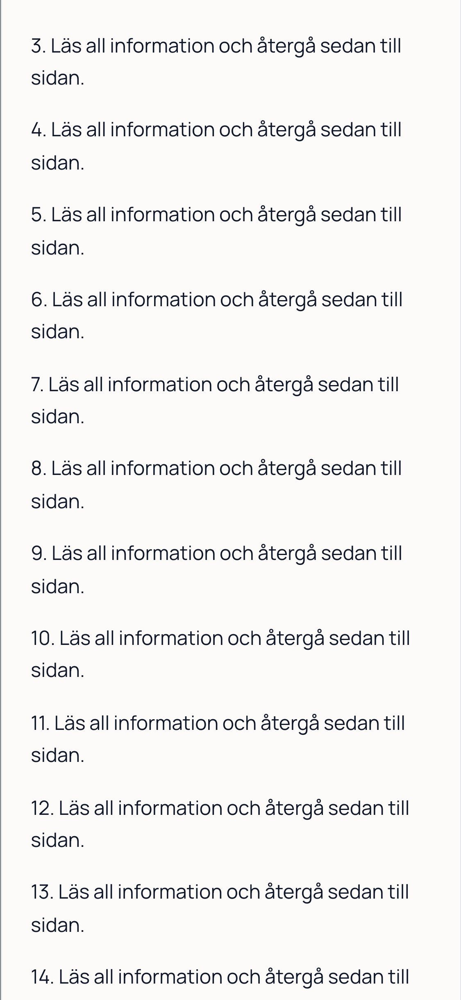
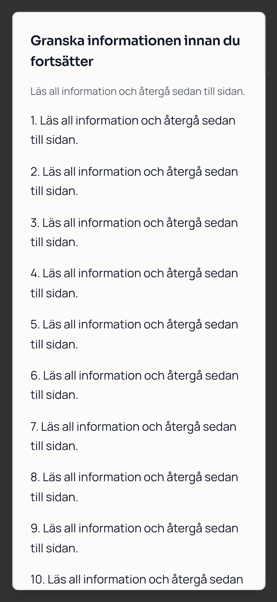
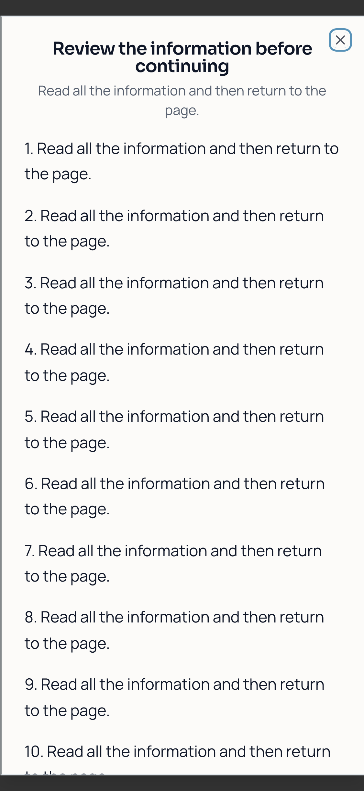
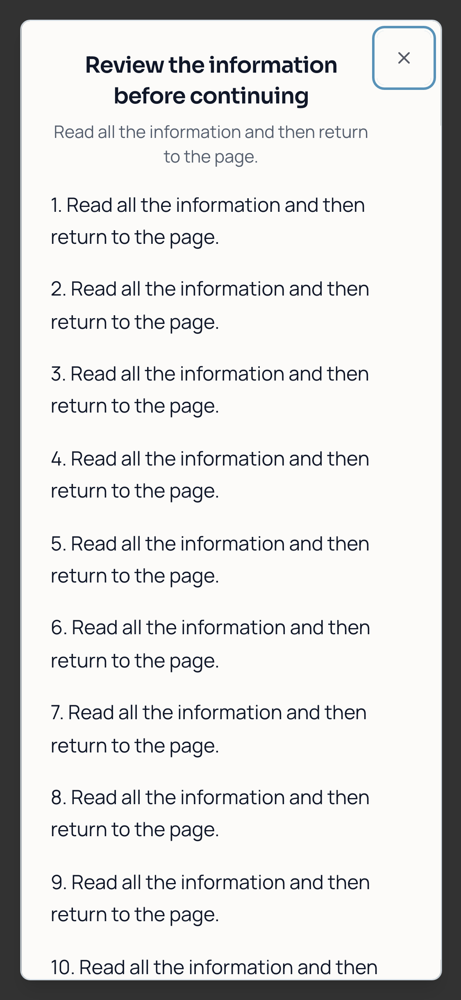
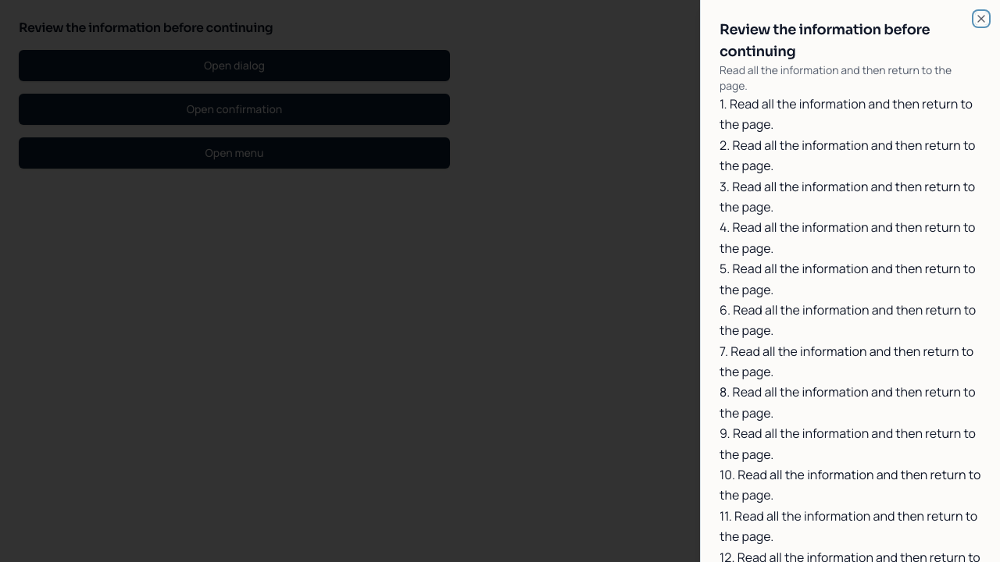
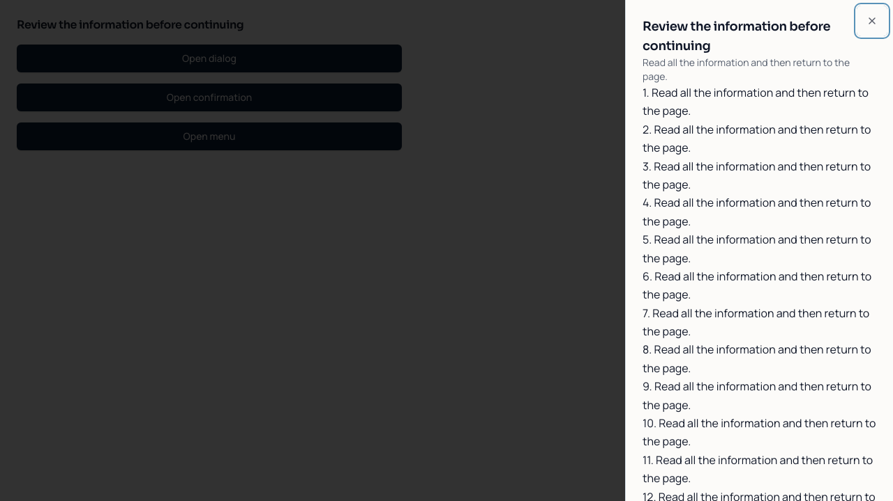

# Platform UX — review and release handoff

Base: `68c8aed` (main, PR #470). Branch: `codex/platform-ux-consistency`.
The PR description records the final implementation commit. Merge and publication belong to Claude's separate release session. This work does not publish anything.

## Changes and why

- Shared dialogs, confirmation dialogs and sheets fit short/mobile viewports and scroll internally. Close controls are 44 × 44 CSS pixels, localized, and separated from heading text. Dialog focus containment and return remain Radix-managed.
- The mandatory terms gate now uses the same accessible dialog primitive. Escape/outside clicks cannot dismiss the requirement; acceptance/sign-out and legal versions are unchanged.
- Public/candidate/admin, employer, assessment and Security Work shells offer a localized keyboard skip link and a focusable main target.
- Shared primary/icon buttons and small mobile buttons have larger touch targets. Selects have readable mobile text and consistent focus/error borders. Card/dialog headings use a readable line height.
- Secondary error and navigation actions retain legible foreground/background combinations on hover.
- Job draft/edit and profile basics/residence/work-country edits warn before leaving or reloading with unsaved changes. Failed saves preserve fields; successful job saves release the navigation guard.
- The Swedish admin login heading wraps at 375px. Employer/application admin search forms shrink within mobile layouts and have explicit accessible names.

No migration, database authorization, authentication contract, assessment scoring, payment integration, credential verification semantics or published Git history changes.

## Evidence: same component, same language and viewport

Before components were read from `68c8aed` using `git show`; the same fixture, fonts and Playwright device configuration rendered both versions. Captures wait for animations and fonts. The confirmation example deliberately contains a long document: previously its title and actions fell outside the viewport; now its panel is bounded and keyboard-accessible, with internal scrolling.

| Scenario                    | Before                                        | After                                       |
| --------------------------- | --------------------------------------------- | ------------------------------------------- |
| Swedish confirmation, 375px |  |  |
| English dialog, 375px       |  |  |
| English sheet, desktop      |    |    |

Real local persistence evidence: [desktop saved CV](chromium-real-saved-cv.png), [mobile saved CV](mobile-375-real-saved-cv.png), [mobile evidence and review request](mobile-375-real-evidence-review.png).
Full local screenshots are in the ignored `artifacts/platform-ux/` directory. CI uploads its own synthetic screenshots and failure traces for 14 days; no real-user session trace is committed here.

## Environment and isolation

The existing default Colima environments were inventoried but had database/containerd disk-I/O failures. They were not repaired, reset or used for writes. A separate task-owned Colima profile `platform-ux-20261015` was created with its own Docker context and volumes. Only its temporary working directory is mounted.

- App: `http://127.0.0.1:3170`, current working-tree implementation.
- Real Supabase Auth/PostgREST/Storage API: `http://127.0.0.1:57721`.
- PostgreSQL: `127.0.0.1:57722`; **394 migrations replayed, zero unexpected failures**.
- Local Mailpit: `http://127.0.0.1:57724`. Email confirmation was enabled for the final registration/recovery test. All messages stayed in Mailpit. No external test email or payment was sent.
- Bun 1.3.14; Node 23.7.0; Playwright 1.61.1 / bundled Chromium revision 1228. Dependencies installed from `bun.lock` with `--frozen-lockfile`. The pre-existing npm lockfile does not support clean `npm ci`; it was not regenerated for a UX change.
- Nine persistent synthetic roles: two candidates, two employer owners, active colleague, outsider, removed member, dedicated `passport_verifier`, platform administrator. Fresh synthetic candidates are also created for each write-journey run. Two tenant fixtures plus the existing isolated job-navigation company are present.
- No hosted project bindings are used by the live scripts. Exact local API guards reject other endpoints. Credentials/sessions are in mode-0600 temporary files, not this repository.

## Verification

| Coverage                                                  | Result / scope                                                                                                                                                                                                                                                                                                                                               |
| --------------------------------------------------------- | ------------------------------------------------------------------------------------------------------------------------------------------------------------------------------------------------------------------------------------------------------------------------------------------------------------------------------------------------------------ |
| Production build / TypeScript                             | Passed locally; no deployment                                                                                                                                                                                                                                                                                                                                |
| Public audit                                              | 8 passed; 4 intentional project skips for desktop-only reflow. 13 public routes, SV/EN, desktop, 375px, 390px, 768px tablet and 640px reflow                                                                                                                                                                                                                 |
| Shared overlays                                           | 6 passed across desktop/375/390 and SV/EN; bounds, close target sizes, keyboard dismissal and focus restoration                                                                                                                                                                                                                                              |
| Candidate/home/CV regression                              | Initial run: 297 passed, 5 failed. All five addressed and the six targeted reruns passed. Fixes: freeze the archived-approval fixture's clock, include the established Security Work nav item, reopen the mobile menu before language switching                                                                                                              |
| Employer portal evidence/regression + admin error scoping | Employer tests: 24 passed, 2 intentional skips. Admin suite: 8 passed after supplying the existing catalogue-facts read in its fixture                                                                                                                                                                                                                       |
| Unsaved employer draft / retry                            | 4 passed, SV/EN desktop/375; simulated server failure, cancelled departure, preserved input, successful retry without spurious prompt                                                                                                                                                                                                                        |
| Real workspace audit                                      | Candidate/employer/admin routes in SV/EN desktop/375; mobile admin overflow found and fixed. Final affected rerun: 4 admin cases and 2 real unsaved-profile cases passed                                                                                                                                                                                     |
| Real Auth + write journey                                 | 4 passed: desktop/375 mandatory terms focus trap/acceptance, profile save/read-back, country, employment, deterministic CV preview/save, credential, private PDF evidence, verification request, PDF job application, confirmation/history, duplicate suppression, employer review-stage change and candidate read-back, reviewer clarification and candidate read-back; employer draft save/reload |
| Real signup + email + recovery                            | 2 passed, desktop/375. Signup, captured confirmation link, new session, captured recovery link, changed password; old password refused and new password accepted by real Auth                                                                                                                                                                                |
| Real API/Storage/RLS                                      | **21/21 passed**, [assertion list](api-results.json): closed catalogue, governed metadata, cross-candidate denial, employer/private Passport separation, privilege escalation denial, private file upload/attach, cross-owner list/download/upload denial                                                                                                    |
| Existing real job navigation                              | 5 passed: filters/return, related job, direct/reload, sign-in-to-apply return, English                                                                                                                                                                                                                                                                       |
| Tenant separation                                         | 10 passed: active colleague allowed; outsider, removed member and other tenant denied; dedicated reviewer denied platform-admin access, desktop/375                                                                                                                                                                                                          |
| Final component/form/error rerun                          | 16 passed: shared overlays, unsaved job save/retry and admin error scoping, desktop/375                                                                                                                                                                                                                                                                      |
| Static guards                                             | `launch-legal:check`, `employer-job-form:check`, `header-entry:check` passed                                                                                                                                                                                                                                                                                 |

## What is simulated or remains outside this evidence

- Error injection, lost responses, CV stale-tab conflicts and retry behavior use existing network-boundary fixtures. The separate real-stack suites do not substitute backend responses.
- The CV uses the product's deterministic fallback, not a paid AI provider. External AI quality, payment execution, hosted email delivery and the Passport public-sharing Edge gateway were not exercised. Edge runtime is excluded from this local stack.
- Mobile devices are Chromium emulations, not physical Safari/iOS or Android. The 200% check is a **CSS-layout reflow equivalent**, not a native browser zoom gesture. It does not establish a full WCAG audit.
- [Route inventory](route-inventory.json) inventories route files including layouts. Browser coverage is the named routes and journeys above, not every state of every route. Assessment authoring/completion, every employer interview/report workflow, real public share recipients and production deployment are not claimed as fully end-to-end verified here.
- No public or authenticated production data was modified. The local environment and synthetic data can be retained for release review; stop only the named task-owned profile when finished.

## Reproduce and hand off

1. Install dependencies with `bun install --frozen-lockfile` and Chromium with `bunx playwright install chromium`.
2. For fixture suites, start the app on port 3100. Run `E2E_BASE_URL=http://localhost:3100 bunx playwright test e2e/platform-ui-foundation.spec.ts e2e/platform-public-audit.spec.ts e2e/platform-unsaved-navigation.spec.ts --project=chromium --project=mobile-375 --project=mobile-390`.
3. For real tests, use a disposable Supabase stack with API 57721, DB 57722, Mailpit 57724, site URL `http://127.0.0.1:3170` and redirect allowance `http://127.0.0.1:3170/**`. Enable email confirmations; keep SMTP pointed at local Mailpit. The scripts intentionally refuse hosted endpoints. Store CLI `supabase status --output json` in `/private/tmp/cqrity-platform-ux-20261015/status.json`, chmod 600.
4. Revoke Supabase's inherited public-function execute defaults for `authenticated`/`service_role` on the fresh stack, then run the repository's `scripts/local-staging-apply.sh` with its local `DB_URL`. Apply `scripts/fixtures/interview-journey-fixture.sql` and `scripts/fixtures/job-back-navigation-fixture.sql`. Run `node scripts/platform-ux-live-setup.mjs` to create role accounts and the private application bucket.
5. Run `node scripts/platform-ux-live-server.mjs`. Then run `PLATFORM_UX_LIVE=1 E2E_BASE_URL=http://127.0.0.1:3170 bunx playwright test e2e/platform-live-journeys.spec.ts e2e/platform-live-auth.spec.ts --project=chromium --project=mobile-375`. API checks: `node scripts/platform-ux-live-api-check.mjs` with `psql` on PATH. The API suite changes only the disposable catalogue while testing denial; do not run it against a shared environment.
6. Claude: review the exact PR head, inspect before/after and CI results, check competing PRs for shared UI/auth-shell changes, merge without rewriting published history, then perform the normal release smoke checks. No dependency on a new schema migration or paid service is introduced by this PR. Merge and publication are deliberately not performed here.
