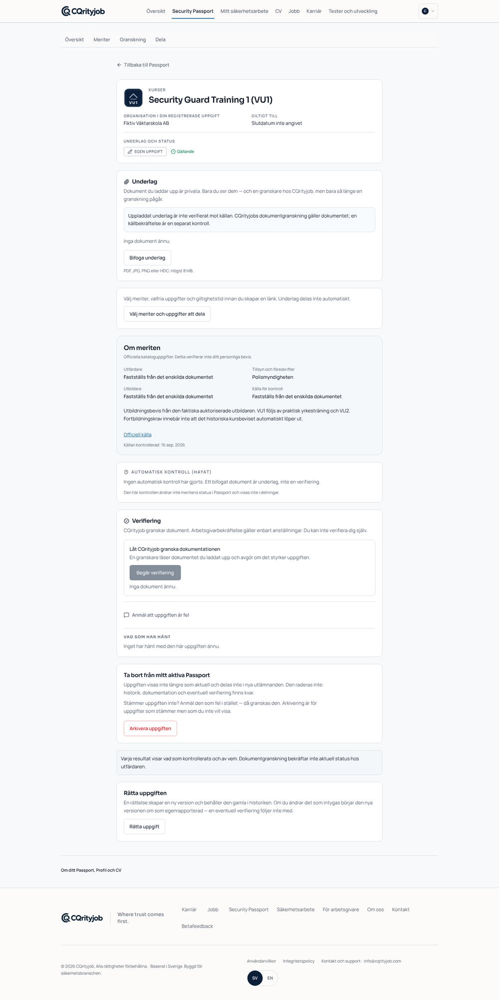
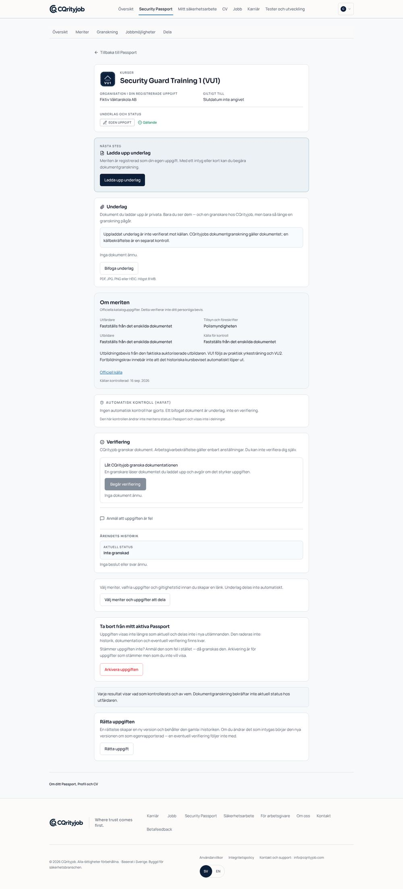
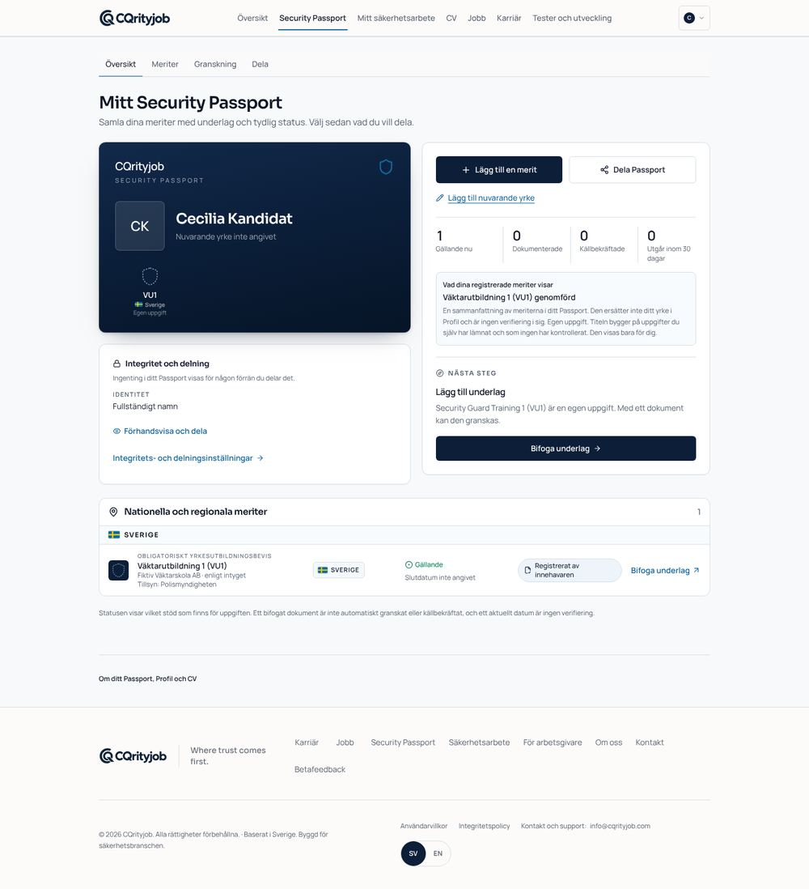
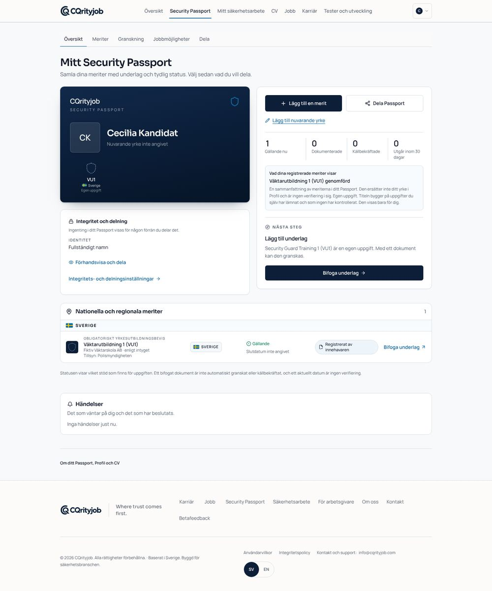
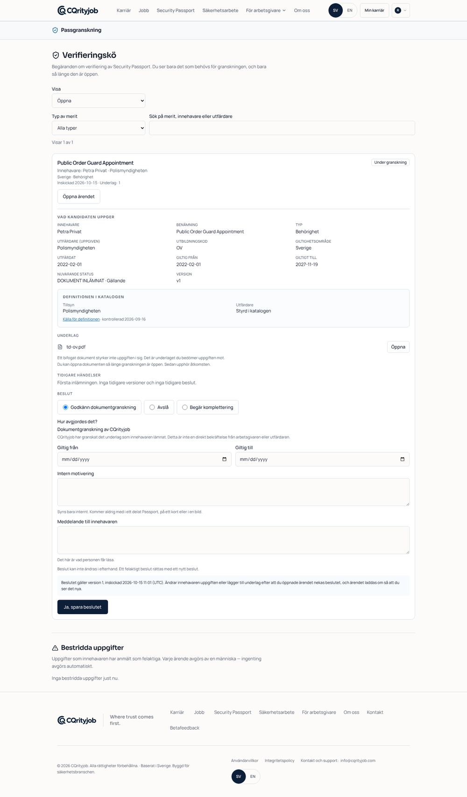
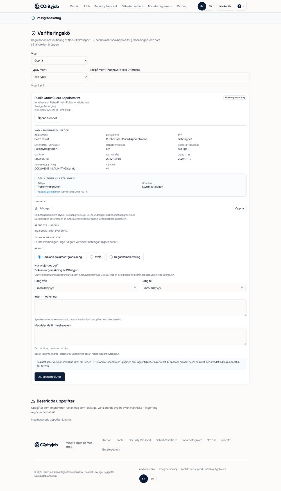
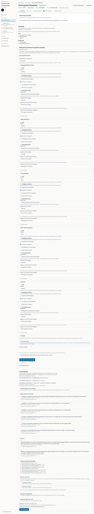
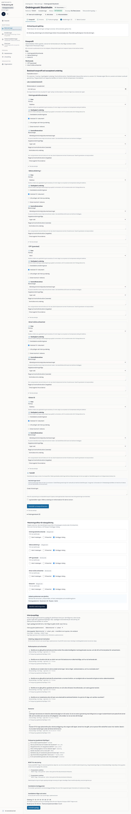
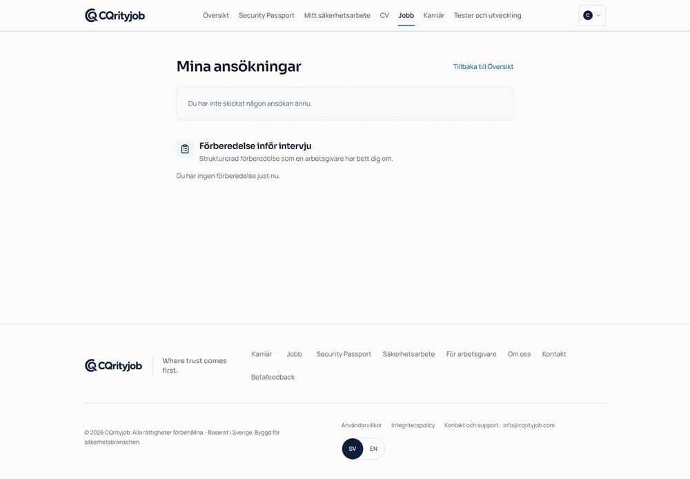

# Security Passport → rekrytering: leveransrapport

Tråden: **registrera → styrk → välj synlighet → bli hittad → kontakt → ansökan och rekrytering**.

| Del                                            | Var                                                                                                                         |
| ---------------------------------------------- | --------------------------------------------------------------------------------------------------------------------------- |
| Nuläge och beroenden                           | [00-nulage-och-beroenden.md](00-nulage-och-beroenden.md)                                                                    |
| Kontrakt för sökning, förklaringar och kontakt | [talent-search-contract.md](talent-search-contract.md)                                                                      |
| Schema (tre slots, rollback, SQL-tester)       | PR cqrityjob/trust-path-recruitment#472 · [releaseanteckning](../../release/2026-10-15-passport-talent-discovery-schema.md) |
| Applikation (den här grenen)                   | `src/lib/talent`, `src/components/talent`, `src/lib/notices`, passport- och arbetsgivarvyerna                               |
| Webbläsartest mot riktig databas               | `e2e/talent-discovery-local.spec.ts` + `scripts/fixtures/talent-discovery-fixture.sql`                                      |
| Bilder och mätvärden                           | [evidence/](evidence/)                                                                                                      |

## Oberoende granskning 2026-10-15

Nio fynd, alla rättade vid sin grundorsak. Varje fynd har ett regressionstest som föll före
rättelsen och går igenom efter. Utfallen finns i [review-2026-10-15/](review-2026-10-15/).
Fynd, commit och test redovisas i PR cqrityjob/trust-path-recruitment#472 (RF1–RF8, schema) och
cqrityjob/trust-path-recruitment#473 (RF6–RF9, appen).

Två fel till hittades i CI efter granskningen och är rättade:

- **RF8 på meritsidan.** Ärendehistoriken och aktuell status kallade varje godkännande
  "Dokumentgranskad", även en arbetsgivarbekräftelse, och innehavaren såg aldrig "Godkänd".
  Nu läses varje godkännande "Godkänd", och vad verifieringen styrker står separat (se
  provenansen nedan). "Nästa steg" säger "Meriten är godkänd".
  Utfall: [`app-rf8-entry-before.txt`](review-2026-10-15/app-rf8-entry-before.txt) och
  [`app-rf8-entry-after.txt`](review-2026-10-15/app-rf8-entry-after.txt).
- **CV-bucketen saknades på den riktiga stacken.** Ingen migration skapar `job-application-cvs`,
  så ansökan med CV föll. Körningen skapar den nu via Storage-API:t med samma inställningar
  som i drift: privat, 5 MiB, bara PDF.

Astras omkontroll hittade ett provenansfel, rättat i både schema och app:

- **Provenans.** `sp_talent_entry_level()` gjorde rå verifieringsmetod till nivå, medan appens
  `effectiveTrust()` behandlar samma uppgifter som dokumenterade. Nu använder SQL samma regel
  (`sp_decision_trust()`): arbetsgivarbekräftad bara för en anställningsperiod som en annan
  organisation än CQrityjob har bekräftat. Allt annat godkänt är dokumentgranskat, också
  `issuer_confirmation` (ingen strukturellt styrkt utfärdare finns) och äldre arbetsgivarbeslut
  som CQrityjob fattade. Den historiska metoden finns kvar i historiken.
  - I appen står beslutet ("Godkänd") och vad det styrker ("Styrks genom: Dokumentgranskning",
    "Bekräftad av arbetsgivare" eller "Källmetod utan strukturell källbekräftelse") på var sin
    rad, i aktuell status, historik, inkorg och mejl.
  - Samma nio syntetiska fall (`supabase/tests/provenance_cases.json`) körs mot SQL och mot
    appens bedömning, och resultaten jämförs. Före rättningen: SQL 15 `not ok`, paritet 6 av 9
    fel, appen överdrev 6 av 9 fall
    ([`provenance-before.txt`](review-2026-10-15/provenance-before.txt),
    [`app-provenance-before.txt`](review-2026-10-15/app-provenance-before.txt)). Efter:
    31 av 31, paritet 9 av 9 och appen 9 av 9
    ([`provenance-after.txt`](review-2026-10-15/provenance-after.txt),
    [`app-provenance-after.txt`](review-2026-10-15/app-provenance-after.txt)).

Pilottestets uppladdning (scenario F) föll en gång på `5ab6ffed`, i båda projekten. Uppladdningsfältet
är avstängt tills sidan har läst innehavarens avbrutna uppladdningar, och en fil som väljs innan dess
ignoreras utan meddelande. Testet valde filen direkt efter sidladdningen. Nu väntar det, som
talangsviten redan gör, tills fältet är aktivt
([`pilot-upload-race.txt`](review-2026-10-15/pilot-upload-race.txt)).

Scenario 12 i webbläsarsviten kör riktig sessionsåterkallelse (utloggning via `/auth/v1/logout`)
och borttagen granskarroll. Det visar också att en arbetsgivares interna anteckning aldrig når
granskaren. Sviten körs inte längre seriellt, så ett tidigt fel lämnar inga scenarier överhoppade.

## Ordning för release

1. **Schema-PR (#472)** mergas och appliceras av Supabase-integrationen. Den ändrar ingen applikationskod;
   inget anropar de nya funktionerna förrän steg 3.
2. Releaseansvarig verifierar det hostade schemat och skriver `applied` i `supabase/release-state.json`.
3. **App-PR** (denna gren) blir merge-bar. `schema-first-release:check` blockerar den till dess, avsiktligt.
4. Mejl: produktion måste deklareras uttryckligen med `PRODUCT_EMAIL_MODE=production`. I alla
   andra miljöer skickas mejl bara till adresserna i `PRODUCT_EMAIL_RECIPIENT_ALLOWLIST`
   (kommaseparerat, `@domän` tillåts). Utan lista skickas inget mejl alls, och notisen markeras
   `not_allowlisted`. I appen syns notisen alltid.

Merge, driftsättning och publicering samordnas med releaseansvarig. Astra granskar oberoende.

## Vad som är verifierat, och var

| Miljö                                                          | Verifierat                                                                                                                                                                                                                                                                                                                                                      |
| -------------------------------------------------------------- | --------------------------------------------------------------------------------------------------------------------------------------------------------------------------------------------------------------------------------------------------------------------------------------------------------------------------------------------------------------- |
| SQL (riktig Postgres 16, strikt replay)                        | Alla migrationer i ordning; sviterna RH1–RH11 (53), TD (33), TS1–TS15 (75); fem planterade negativa kontroller; rollback av alla tre slots inklusive vägran när data finns; `db-test.sh` grönt.                                                                                                                                                                 |
| Lokal stack: Postgres 16 + PostgREST 12.2.3 + appen i Chromium | 13 scenarier, inte seriella, alla gröna (se nedan).                                                                                                                                                                                                                                                                                                             |
| **Substitut** i den lokala stacken                             | Auth (GoTrue) och Storage ersätts av repots `scripts/local-stack/auth-gateway.mjs`: riktiga JWT, riktig RLS och riktiga `storage.objects`-rader, men inte GoTrue- eller Storage-binärerna. Docker-registren var blockerade i arbetsmiljön. Mejl går till en mejlfångare i gatewayen; inget lämnar processen. CI-jobben med riktig GoTrue/Storage körs i GitHub. |
| Produktion (`wrygicdfxwjnrugduxnt`)                            | **Inte rörd.** Ingen migration, ingen data, inget mejl.                                                                                                                                                                                                                                                                                                         |

### Webbläsarscenarier (`e2e/talent-discovery-local.spec.ts`)

Syntetiska personer: kandidaterna Cecilia (A), Bo (B) och Petra (C, privat), granskare, ägare,
rekryteringsansvarig, kollega utan behörighet och ägare på ett annat företag (två företag).

1. A registrerar CPP via guiden (osparade ändringar varnar), laddar upp underlag. Nästa steg är **Begär
   granskning**, inte Dela. Dubbelklick ger en begäran. Mätvärden registreras.
2. Granskaren begär komplettering. A får en notis i appen och ett mejl (fångat).
3. A svarar i text, bundet till versionen.
4. En granskningsvy som öppnats före svaret nekas (`SP_REVIEW_STALE`). Efter omladdning läser granskaren
   svaret och godkänner.
5. A ser en aktuell status och historiken, och blir sökbar med valda meriter. Standardläget är privat, och
   mobilbredd fungerar utan sidledsrullning.
6. Ägaren kopplar kraven till katalogen: en internationell certifiering kan inte stå för en reglerad
   behörighet. En kollega utan behörighet och ett annat företag nekas, både i UI och via direkt API-anrop.
7. Rekryteraren ser två personer med förklaring per krav ("inte bland delade uppgifter – betyder inte att
   personen saknar det"). Ingen poäng visas, filtren är faktabaserade och ordningen redovisas. Den privata
   personen syns inte, räknas inte och går inte att nå via API.
8. A läser vem, vilken tjänst och vad ett ja innebär, och accepterar (dubbelklick ger ett svar). Ingen
   ansökan skapas förrän A själv söker; Passport-valet är hennes.
9. Rekryteraren fortsätter i den befintliga ansökningsvyn.
10. Återkallelse och paus slår igenom vid nästa läsning; den gamla referensen slutar fungera. Den daterade
    ögonblicksbilden visas separat som historik.
11. Avslag: innehavaren läser granskarens meddelande men aldrig den interna anteckningen, varken i UI eller
    API. En borttagen behörighet stoppar sökning och kontaktlistan direkt. Sidan fungerar på engelska vid
    1440 och 390 px, och synlighetsvalet kan nås och ändras med tangentbordet. 200 % zoom kontrolleras som
    halv bredd utan sidledsrullning.
12. En utloggad session läser ingenting, även med en ännu giltig åtkomsttoken. En borttagen granskarroll
    stänger inkorg och ärendetråd direkt. En arbetsgivares interna anteckning når aldrig granskaren.
13. Rättad merit och rättad erfarenhet: A rättar sin granskade CPP via "Rätta uppgift" (en ny version,
    ogranskad) och byter roll på sin anställning på CV-sidan. Arbetsgivaren läser den aktuella versionen:
    CPP som egen uppgift, anställningen under sin nya roll, och inget av den ersatta, granskade versionen.
    Sökurvalet följer rättelsen till den nya versionen (`sp_talent_items`).

Kör lokalt: `scripts/local-stack/up.sh --reseed`, därefter fixturen och sedan
`E2E_LOCAL_STACK=1 … bunx playwright test e2e/talent-discovery-local.spec.ts`.

### Fel som testet hittade och som är rättade

- Katalogsökningen i kravprofilen visade de första åtta träffarna i katalogordning, så "OV" gav inte
  Ordningsvaktsförordnande. Nu rangordnas exakt förkortning först, följt av prefix och sedan övriga träffar.
- Lokala gatewayen skickade CORS-huvudet två gånger och nekade `x-retry-count`, vilket gjorde att
  annonssidan inte gick att läsa i webbläsaren. Den nekade också serverns uppladdning av CV med servicerollen,
  som riktig Storage tillåter. Båda gäller bara testmiljön.

## Före och efter

Bilderna är tagna mot samma databas: "före" från `main`-appen, "efter" från den här grenen.

| Vy                        | Före                                                 | Efter                                               |
| ------------------------- | ---------------------------------------------------- | --------------------------------------------------- |
| Merit, egen uppgift       |  |  |
| Passport-översikt         |    |    |
| Granskarens ärende        |          |          |
| Kravprofil (arbetsgivare) |     |     |
| Mina ansökningar          |      |      |

Fler bilder från scenarierna (sv/en, 1440/390/720) finns i [evidence/](evidence/).

## Mätvärden

Endast händelsenamn och tid sparas (`product_metric_events`), med räkningar som bara administratörer kan
läsa. Inget dokumentinnehåll och inga personuppgifter. Från körningen:
[evidence/metrics.json](evidence/metrics.json). Händelserna är `passport_first_merit_saved`,
`passport_review_requested`, `talent_visibility_enabled`, `talent_contact_requested` och
`talent_contact_accepted`.

## Kvar och kända begränsningar

- Katalogen och HAYAT är orörda: inga nya certifieringar, inga utfärdarkällor aktiverade.
- Krav som inte finns i katalogen (t.ex. körkort) klarläggs i dialog och räknas aldrig som uppfyllda eller
  saknade.
- Riktig GoTrue/Storage i webbläsartestet körs i CI, inte i den lokala körningen (se substitut ovan).
